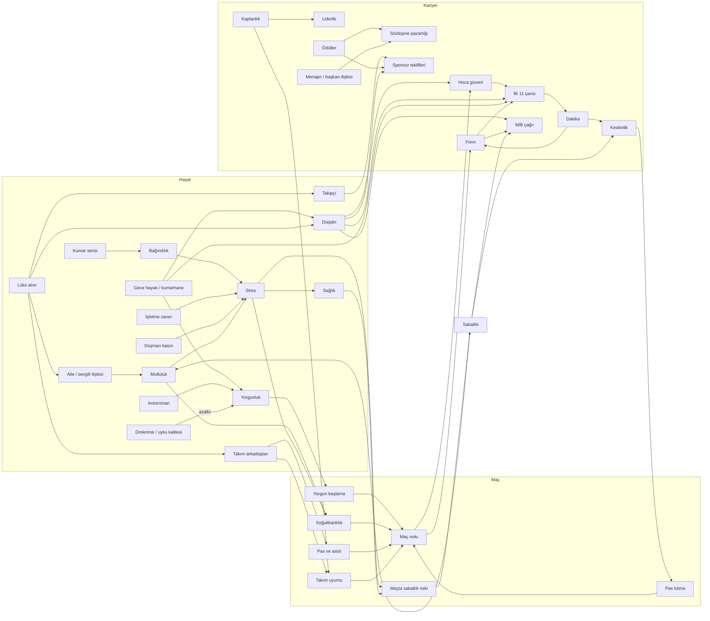

# Sistem haritası: kelebek etkisi (Ekim 2026)

Sahip ilkesi: *"Bir futbolcu yaratıp hayatını yönetiyoruz. Her şey gerçek hayattaki gibi bir bütün; en küçük
şeyin bile bir yerde etkisi olmalı."* Bu belge oyuncunun ve dünyanın her durum değerini **kimin yazdığını**
ve **kimin okuduğunu** (yani hangi sonucu doğurduğunu) listeler, ana nedensellik zincirlerini çizer, çıkmaz
sokakları (yazılan ama hiçbir sonucu olmayan değerler) ve bu turda nasıl bağlandıklarını kaydeder.

Yöntem:

- **Statik analiz.** `src/sim/**` (test dışı) üzerinde her alan için atama (`x.alan =`, `+=`, olay deltası
  `key: 'alan'`) ve okuma (`.alan`) taraması; olay bayrakları (`life.flags`) için ayrıca `setFlags` /
  `addFlags` / `flags.x =` yazımları ile `hasFlag` / `flagNum` / `flags.x` okumaları eşleştirildi. Tarayıcı
  betikleri depoya konmadı (oturum çalışma alanında), sonuçlar aşağıdaki tablolara elle işlendi.
- **Çalışma zamanı kontrolü.** `src/sim/game/butterfly.test.ts`: 37 senaryo ve 32 bayraklık tarama; her biri aynı tohumdan iki
  kariyer kurar, **tek bir küçük eylemi** değiştirir ve haftalar sonraki etkiyi kontrol kopyasıyla karşılaştırır.

Kısaltmalar: *H* = `hero`, *L* = `life`, modül yolları `src/sim/` altındadır.

## 1. Etki tablosu

### 1.1 Oyuncu (H)

| Durum | Yazanlar | Okuyanlar → sonuç |
|---|---|---|
| Özellikler (`attrs`, `attrXp`) | antrenman (`career/training`), maç XP'si ve maç içi eylemler (`career/matchOutcome`), aktiviteler (spor salonu, video, mentorluk), olay kartları (`attr` deltası), yaşlanma ve hareketsizlik erimesi (`career/progression`, `career/decay`), **kaptanlık** (liderlik XP'si, yeni) | OVR → rol ve ilk 11 (`career/squadRole`), maç motoru ve anlar (`match/*`), transfer ilgisi ve maaş (`career/transfers`, `career/contract`), milli çağrı (`game/national`), sakatlık direnci (`bodyInjuryFactor`), toparlanma (dayanıklılık) |
| Form (`form`) | maç notu (`matchOutcome`), milli maç, olaylar, kumar bedeli (`life/casino`), dünya sezonu | ilk 11 şansı (%±12), maç anı sayısı (`match/engine`), piyasa değeri, transfer ilgisi, milli çağrı (%12), röportaj tonu, **lüks alışverişte taraftar tepkisi** (form < 45, yeni) |
| Moral (`morale`) | maç sonucu, rol değişimi, yedek serisi, sakatlık, tükenmişlik, röportaj, olaylar, **soğuk soyunma odası** (yeni) | mutluluk hedefi (`life/wellbeing`), maç kararları (`match/decisions`), motor |
| Maç temposu (`sharpness`) | maçta dakika (+12/90'), antrenman, haftalık −6 (dakika yoksa), sakatlık dönüşü −20 | ilk 11 (< 40: −%10), hareketsizlik erimesi (`career/decay`), **maçta pas tutma: keskinlik < 55 → fizik/teknik özellikler −%6'ya kadar** (yeni) |
| Yorgunluk (`fatigue`) | maç (+dakika, deplasman yolu), antrenman, gece hayatı, **kumarhane (+5, yeni)**, dinlenme/uyku/tesisler (−) | ilk 11 (> 60: rotasyon), antrenman XP verimi, antrenman sakatlık riski, otopilot planı, **maça yorgun başlama: yorgunluk > 40 → motorda başlangıç yorgunluğu** (yeni) |
| Sakatlık (`injury`) | maç motoru (oto anlar), antrenman, olaylar (`injury` deltası), ağrı kesici iğne kartı | oynayamama, mutluluk/stres hedefi, sağlık −8׺iddet, moral, hareketsizlik erimesi, milli çağrı (> 2 hafta: −20), sigorta ödemesi |
| Ceza (`suspendedMatches`) | kırmızı/sarı kart, olaylar, hakem defteri | oynayamama, cezayı tribünde izleme |
| Teknik direktör güveni (`managerTrust`) | maç notu, antrenman performansı, disiplin olayları, şikâyet, röportaj, haftalık sürüklenme (hoca ilişkisi + disiplin) | rol merdiveni, ilk 11 (%±8), kenara alınma riski, sözleşme yenileme (< 30 yenilenmez), stres hedefi |
| İtibar (`reputation`) | maç, sezon duruşu, kupalar, ödüller, transfer, olaylar, aktiviteler, lüks alım (ünlenme), projeler, **dost basın (yeni)** | maaş ve piyasa değeri, sponsor markaları ve teklif sıklığı, takipçi tavanı, transfer ilgisi, kumarhanede tanınma, işletme geliri, milli çağrı, Onur Listesi |
| Takipçi (`followers`) | maç, paylaşımlar, organik büyüme, olaylar, röportaj, **lüks alım fotoğrafları (yeni)** | sponsor imajı ve **teklif sıklığı (log eğrisi, yeni)**, nefret yorumları (stres), **basın baskısının şiddeti (yeni)**, hedefler |
| Ödüller (`awards`) | sezon/ay ödülleri (`game/awards`, `world/awards`) | itibar, Onur Listesi, **sözleşme pazarlığı (+%3/ödül, yeni)**, **sponsor teklif sıklığı (yeni)** |
| Sözleşme, rol | transfer/yenileme, rol değerlendirmesi | maaş, ilk 11 tabanı, **kaptan: liderlik XP'si + takım uyumu (yeni)** |

### 1.2 Hayat (L)

| Durum | Yazanlar | Okuyanlar → sonuç |
|---|---|---|
| Enerji (`energy`) | aktiviteler, antrenman, sabah yenilenmesi (uyku kalitesi, akşamdan kalma) | aktivite kilidi, **maç günü enerji < 40 → yorgun başlama (yeni)** |
| Mutluluk (`happiness`) | haftalık hedefe çekilme (yakın çevre, moral, varlıklar, borç, sakatlık), aktiviteler, olaylar, hedefler | maç soğukkanlılığı (`mentalMatchModifier`), stres hedefi, antrenman XP'si, kriz haftası (yakın arkadaş desteği) |
| Sağlık (`health`) | sakatlık, kronik stres, haftalık toparlanma, aktiviteler, olaylar | enerji tavanı, antrenman sakatlık riski, **maç sakatlık riski (yeni)** |
| Stres (`stress`) | haftalık hedef (sakatlık, borç, kumar, güvensizlik, mutsuzluk, maç yükü), işletme, sosyal medya, rol düşüşü, **düşman basın, sevgili krizi, soğuk soyunma odası, işletme zararı (yeni)** | soğukkanlılık, tükenmişlik, sağlık erimesi, antrenman ve **maç** sakatlık riski |
| Disiplin (`discipline`) | gece hayatı, kumarhane (görülme), kartlar, şikâyet, paylaşım, olaylar, **lüks şov (genç oyuncu, yeni)**, tesis yatırımı (+) | güven sürüklenmesi, sponsor imajı ve **teklif sıklığı**, taraftar grupları, **ilk 11 (< 40, yeni)**, **milli çağrı (< 40, −10'a kadar, yeni)**, **pazarlık (yeni)** |
| Para, banka, kredi, kredi notu | maaş, primler, sponsorlar, işletmeler, yatırımlar, harcamalar, kumar | mutluluk/stres hedefi (borç), iflas koruması, kredi faizi (kredi notu), satın alma kilitleri |
| Varlıklar (`assets`) | mağaza (`buyAsset`), satış, olaylar | pasif mutluluk, bakım gideri, sponsor imajı, uyku kalitesi, toparlanma tesisleri, **ev → aile/sevgili +3; gösteriş ürünü → takipçi, manşet, taraftar, kıskançlık, disiplin (yeni)** |
| İşletmeler | aç/geliştir/sat, haftalık bilanço, olay kartları | gelir, net servet, sahip stresi, **zarar haftası → stres (yeni)** |
| Projeler (akademi, stadyum, hisse, fon) | proje kartları | taraftar, itibar, mutluluk, Legacy çocuğuna itibar + para, başkan ilişkisi |
| Sponsorlar | teklif kabulü, ahlak maddesi, süre bitişi | haftalık gelir, performans primi, **provokatif paylaşım patlaması → ahlak maddesi (yeni)** |
| Kumar (`casino.addiction`, VIP) | ziyaretler, oyunlar, olaylar | stres hedefi, haftalık kumar bedeli (form, mutluluk, disiplin, yakınlar), basına sızma, **maç öncesi gece: seçilme şansı ve yorgun başlama (yeni)** |
| Bayraklar (`flags`) | olay kartları, aktiviteler, sistemler | olay koşulları ve zincirler; bkz. §3.3 (yalnızca anlatı hafızası olanlar) |
| Hedefler (objectives) | menajer, aile, sponsor, kulüp hedefleri | ödül/ceza (para, mutluluk, ilişki); **unutulan doğum günü: ilişki −8, mutluluk −3 (yeni)** |
| Başarımlar (achievements) | durum taraması | yalnızca meta ilerleme (bilinçli: dünyada sonucu yok) |

### 1.3 İlişkiler

| İlişki | Yazanlar | Okuyanlar → sonuç |
|---|---|---|
| Anne, baba, kardeşler | aile ziyareti, olaylar, ihmal erimesi, hedefler, kumar ihmali, **yeni ev (yeni)** | yakın çevre ruh hali → mutluluk → soğukkanlılık; otopilot akşam planı |
| Sevgili | randevu, olaylar, ihmal (en hızlı), kumar ihmali, **lüks alım (yeni)** | yakın çevre (×2 ağırlık), olay koşulları, **kriz (≤ −30) → haftalık stres (yeni)** |
| En yakın arkadaş, yakın arkadaşlar | aktiviteler, olaylar | yakın çevre, kriz haftası desteği, maçta pas bonusu (yakın arkadaş takım arkadaşıysa) |
| Takım arkadaşları | maç (adil suçlama), aktiviteler, olaylar, mizaç sürüklenmesi, **lüks kıskançlığı (yeni)** | pas ağı ve asist (motor `relationToHero`, `feedWillingness`), arka plan katılımı, **takım uyumu → takım morali (yeni)**, **yalnızlık stresi (yeni)** |
| Teknik direktör | maç, antrenman, disiplin, şikâyet, röportaj, golf, **tesis yatırımı (yeni)** | güven sürüklenmesi, kaptanlık şartı, röportaj |
| Menajer (agent) | işe alım, olaylar, ihmal, röportaj | **pazarlık marjı ±%4 ve sabır ±10 (yeni)** |
| Başkan | olaylar, projeler (hisse), röportaj | olay ağırlıkları, **yenilemede pazarlık marjı ±%5 (yeni)** |
| Taraftar | maç, olaylar, paylaşım, şikâyet, akademi/stadyum, memleket | nefret yorumu olasılığı, kriz haftası, transfer tepkisi, sosyal akış |
| Basın | röportaj, aktiviteler, paylaşım, kumar sızıntısı, **lüks manşeti (yeni)** | olay şartları, **düşman basın (≤ −30) → haftalık stres (takipçiyle artar); dost basın (≥ 40) → az da olsa ün (yeni)** |
| Milli takım hocası | milli maçlar, olaylar | çağrı ölçeği (%12) |

### 1.4 Dünya

| Durum | Yazanlar | Okuyanlar → sonuç |
|---|---|---|
| Kulüp sıralaması, lig, kupalar | dünya sezonu, maç sonuçları | sezon sonu ün, şampiyonluk ünü ve primleri, yönetim hedefleri, Onur Listesi, terfi primi |
| Milli takım (çağrı, kep) | çağrı ölçeği, milli maçlar | itibar, takipçi, yorgunluk ve sakatlık (milli maç), form/moral/keskinlik, başarımlar |
| Ödüller ve kupalar | sezon/ay ödülleri, şampiyonluklar | itibar, **pazarlık ve sponsor (yeni)**, Onur Listesi, Legacy |

## 2. Ana nedensellik zincirleri

## 3. Çıkmaz sokak avı

### 3.1 Bulunan ve bağlanan çıkmazlar (bu tur)

| # | Çıkmaz (önce) | Gerçek hayattaki karşılığı (şimdi) | Kod | Görünürlük |
|---|---|---|---|---|
| 1 | Yorgunluk, enerji ve gece eğlencesi yalnızca seçilmeyi etkiliyordu; seçilen oyuncu maça hep dinç başlıyordu | Yorgunluk > 40, maç günü enerji < 40 ve dün gece dışarıdaysa motorda başlangıç yorgunluğu (en fazla 0,3): bacaklar erken ağırlaşır, geç dakikalarda özellikler düşer, oyuna katılım azalır | `life/butterfly.preMatchCondition`, `match/engine.initMatch` | maç sonu "Maça nasıl geldin?", günlük |
| 2 | Keskinlik maçın kendisini etkilemiyordu | Keskinlik < 55: fizik ve teknik özellikler en fazla −%6 (pas tutma) | `applyRust`, `game/match.buildTeamFrom` | maç sonu, günlük |
| 3 | Sağlık ve stres maçta sakatlık riskini etkilemiyordu (yalnızca antrenmanda) | Yaşam kaynaklı yatkınlık (sağlık, stres > 70, tükenmişlik, `injury_resist` yeteneği) motora `proneness` olarak gider | `lifeInjuryProneness`, `match/engine.heroInjuryRisk` | maç sonu |
| 4 | Dün gece kumarhane / kulüp, ertesi günkü kadro seçimine yansımıyordu (yalnızca görülürse disiplin) | Isınmada belli olur (−%6); gece kulübü (−%6 daha) ya da kumarhanede görülme (−%9 daha) hocanın kulağına gider | `preMatchNightPenalty`, `career/squadRole.startProbability` | "Neden?" paneli: "Dün geceki kumarhane ziyareti teknik direktörün kulağına gitti." |
| 5 | Kumarhane ziyareti yorgunluk bırakmıyordu | +5 yorgunluk, maç öncesi gece disiplin −2 (gece kulübü −6 idi) | `data/activities` | aktivite özeti |
| 6 | Disiplin yalnızca güven sürüklenmesi ve sponsor imajına gidiyordu | Disiplin < 40: ilk 11 −%10'a kadar, milli çağrı −10 puana kadar, sponsor teklif sıklığı −0,05, pazarlık marjı −%3 | `disciplineSelectionPenalty`, `nationalConductPenalty`, `sponsorOfferChance`, `negotiationLeverage` | "Neden?" paneli, milli takım kartı, sponsor "Neden?", sözleşme ekranı |
| 7 | Lüks alım yalnızca ün veriyordu | Gösteriş ürünü (yıllık maaşın ≥ %5'i): takipçi, büyük alımda manşet (form düşükse ya da gençse olumsuz), form < 45 iken taraftar tepkisi, 23 yaş altında takım arkadaşları kıskanır ve sezon içinde disiplin düşer, sevgili sevinir; ev aileyi ve sevgiliyi ısıtır; tesis hocayı etkiler | `luxuryReaction`, `game/actions.buyAsset` | işlem satırı, haber, ilişki defteri ("… kıskançlığı") |
| 8 | Menajer ve başkan ilişkisi sözleşme pazarlığını etkilemiyordu | Menajer ilişkisi ±%4 marj ve ±10 sabır; başkan (yenileme) ±%5; sadakat sözü +%2 | `negotiationLeverage`, `game/actions.startNegotiation` | sözleşme ekranı "Pazarlığı etkileyenler" |
| 9 | Ödüller pazarlık ve sponsorlara doğrudan yansımıyordu (yalnızca itibar üzerinden) | Bu ya da geçen sezonun her ödülü pazarlıkta +%3 (en fazla +%9), sponsor teklif sıklığında +0,03 | aynı + `life/sponsors.sponsorOfferChance` | sözleşme ekranı, sponsor "Neden?" |
| 10 | Takipçi sponsor teklif sıklığına yalnızca 100K eşiğinde etki ediyordu | 10K üstünde her on kat +0,03 (en fazla +0,09) | `sponsorOfferChance` | sponsor "Neden?" |
| 11 | Basın ilişkisi neredeyse hiçbir şeyi etkilemiyordu | Düşman basın (≤ −30) haftalık stres (takipçi arttıkça şiddetlenir); dost basın (≥ 40) az ün | `weeklyClimate`, `game/calendar` | günlük (4 haftada bir satır) |
| 12 | Sevgili krizi ve soğuk soyunma odası doğrudan bir yük getirmiyordu | Sevgili ≤ −30: haftalık stres +2; takım ortalaması ≤ −25: stres +1,5 ve moral −1 | `weeklyClimate` | günlük |
| 13 | Takım arkadaşlarıyla bağ yalnızca pasları etkiliyordu | Takım uyumu: takım morali ±%4 (kaptan + liderlik 70 → +%1) | `dressingRoomChemistry` | maç sonu |
| 14 | Kaptanlık yalnızca baraj kurmayı ve takım kaldırmayı etkiliyordu | Kaptan olarak oynanan her 90' liderlik +0,8 XP, soğukkanlılık +0,2 XP | `career/matchOutcome` | özellik gelişimi |
| 15 | İşletme zararı stres doğurmuyordu (yalnızca sabit sahiplik stresi) | Zarar haftası: maaşa oranla stres +0,5..+4 (müdür varsa yarısı) | `life/business.weeklyBusinessTick` | günlük: "zararda: uykuların kaçıyor" |
| 16 | Provokatif paylaşım patlaması sponsorlara ulaşmıyordu | Ahlak maddesi kontrolü (gaf, şiddet 1) | `life/social.makePost` | fesih satırı ve haberi |
| 17 | `in_therapy` bayrağı yazılıyor, okunmuyordu | Terapi: soğukkanlılık +0,02, haftalık stres −1 | `life/wellbeing`, `weeklyClimate` | maç sonu (soğukkanlılık satırı) |
| 18 | `loyalty_pledge` bayrağı yazılıyor, okunmuyordu | Yenilemede pazarlık marjı +%2 | `negotiationLeverage` | sözleşme ekranı |
| 19 | `penalty_taker` bayrağı yazılıyor, okunmuyordu (penaltıcılık kartı) | Penaltıcı sensen biraz daha zayıf olsan bile vurursun (eşik ×0,85); topu arkadaşına bıraktıysan vurmazsın | `MatchSetup.heroPenaltyTaker`, `match/engine.penaltyAwarded` | maç anları |
| 20 | Unutulan anne/baba doğum günü sıradan bir akşam yemeği kadar hafifti | İlişki −8 ve mutluluk −3 → yakın çevre → soğukkanlılık | `game/objectives` | hedef sonucu, ilişki defteri |

### 3.2 Doğrulanan (zaten var olan) zincirler

- Takım arkadaşı ilişkisi → pas ağı (`feedWillingness`), asist veren seçimi (`relationWeight`), arka plan katılımı.
- Hoca güveni ↔ ilk 11 ↔ dakika ↔ keskinlik ↔ form (`squadRole`, `condition`, `matchOutcome`).
- Milli çağrı ↔ kulüp formu, dakika payı; milli maç → yorgunluk, sakatlık, form, moral.
- Sakatlık → hareketsizlik erimesi (`career/decay`), moral −4׺iddet, sağlık −8׺iddet, mutluluk/stres hedefi.
- Yaş → özellik bazında düşüş (fizik önce, oyunu okuma korunur; `weeklyAging`).
- Kumar serisi → bağımlılık → stres hedefi (+%25'e kadar) → soğukkanlılık; kumar bedeli (form, mutluluk, disiplin, yakınlar).
- Akademi → taraftar ve ün her hafta → Legacy çocuğuna itibar bonusu.
- Uyku kalitesi / dinlenme / diyet → yorgunluk toparlanması ve yaşlanmanın yavaşlaması.

### 3.3 Anlatı bayrakları artık yankılanıyor (0 çıkmaz)

Önceki turda 32 olay bayrağı yalnızca hikâye hafızasıydı. Hepsi `src/sim/life/echoes.ts` üzerinden gerçek
hayattaki karşılığına bağlandı. Haftalık katman (`weeklyEchoes`, `game/calendar` haftalık tikinde) bayrağın
ilk görüldüğü haftayı `echo:<bayrak>` altında tutar; bir söz tutulunca ya da bir sır ortaya çıkınca bayrak
`'kept'`, `'broken'`, `'leaked'` gibi bir duruma yazılır ve ikinci kez tetiklenmez. Rastgelelik yalnızca
bayrak beklemedeyken ve verilen `Rng` ile kullanılır (deterministik). Kulübe bağlı bayraklar (taktik sesi,
yedek kaptanlık, pazubent devri, stoper kodları, yenileme pazarlığı) kahraman kulüp değiştirince `'past'` olur.

| Bayrak (olay) | Gerçek hayattaki karşılığı | Kod | Görünürlük |
|---|---|---|---|
| `abroad_class` (dil kursu) | Aynı ülkede kaldıkça 24 hafta boyunca 4 haftada bir takım arkadaşları +1 (25'e kadar) ve stres −1 | `weeklyEchoes` | günlük ("şakaları artık anlıyorsun"), ilişki defteri |
| `armband_passed` (pazubent devri) | Aynı kulüpte takım uyumu +%1; Onur Listesi +10 ve belgesel satırı | `echoChemistry`, `echoLegacy` | maç sonu "Maça nasıl geldin?", Onur Listesi dökümü |
| `business_curious` (kuzenin iş fikri, "kendi işini kur") | İlk açılan işletmenin marka puanı 40 yerine 46 (ödev yapıldı); bayrak tüketilir | `businessHomework`, `life/business.openBusiness` | işletme kartındaki marka |
| `cb_link_code` (stoper ikilisinin kodu) | Aynı kulüpte takım uyumu +%0,5 | `echoChemistry` | maç sonu |
| `child_letter` (gelecekteki çocuğa mektup) | Onur Listesi +5, belgesel satırı; Legacy çocuğu mutluluk +6, stres −5, ebeveyn ilişkisi +10 | `echoLegacy`, `legacy.applyLegacyStart` | Legacy başlangıç günlüğü ("Kasada mektubu buldun") |
| `curfew_breaker` (yakalanmadan gece kaçamağı) | Alışkanlık: 10 hafta boyunca disiplin −0,2/hafta (toplam −2) | `weeklyEchoes` | günlük |
| `diet_plan` (diyetisyenle sezon) | 38 hafta boyunca sağlık +0,25/hafta (92'ye kadar), yorgunluk −0,5/hafta | `weeklyEchoes` | günlük (sezon sonu satırı) |
| `family_siblings` (kardeş sayısı, yaratılışta) | Stres 55 üstündeyken kardeş başına −0,15/hafta (yük paylaşılır, en çok 2 kardeş) | `weeklyEchoes` | (sessiz; stres) |
| `fixing_backed_out` (şikeden son anda dönmek) | Şantaj çözülene kadar en çok 10 hafta stres +0,5/hafta | `weeklyEchoes` | günlük ("bilinmeyen numaralar") |
| `fixing_buried` (sus payı) | 26 hafta stres +0,3/hafta; sonra %35 ihtimalle haber patlar (itibar −3, disiplin −4, basın −6, başkan −5, sponsor −0,04, Onur Listesi −20), yoksa yük kalkar (stres −3) | `weeklyEchoes`, `echoSponsor`, `echoLegacy` | haber, günlük, sponsor "Neden?" |
| `fixing_cleared` (soruşturma delil yetersizliğinden kapandı) | Pazarlık marjı aynı kulüpte −%3 (başka kulüpte −%1); sponsor sıklığı −0,02 | `echoLeverage`, `echoSponsor` | sözleşme ekranı, sponsor "Neden?" |
| `fixing_refused` (sessizce reddetmek) | 8 hafta stres +0,3/hafta, sonra gurur: disiplin +2; Onur Listesi +10 ("şikeye hayır") | `weeklyEchoes`, `echoLegacy` | günlük, belgesel |
| `foundation_pitches` (vakfın ikinci sahası) | 104 hafta boyunca 8 haftada bir taraftar +1 (40'a kadar); Onur Listesi +15 ve belgesel satırı | `weeklyEchoes`, `echoLegacy` | ilişki defteri, belgesel |
| `friend_entourage` (arkadaşı ekibe almak) | 52 hafta maaşın %3'ü (en az 150) haftalık gider, 6 haftada bir menajer −1 | `weeklyEchoes` | günlük (başta ve sonda) |
| `grandma_promise` ("yazın gelirim" sözü) | Bir aile ziyareti (`family_visit`) sözü tutar: baba +6, mutluluk +4. Yaz ziyaretsiz geçerse: baba −6, anne −3, mutluluk −3 | `activityEcho`, `weeklyEchoes` | aktivite satırı, günlük, ilişki defteri |
| `homecoming_plan` ("sözleşme bitince dönelim") | Bir sonraki kulüp memlekette ise sevgili +10, mutluluk +6; başka bir ülke ise sevgili −10, stres +3 | `weeklyEchoes` (kulüp değişimi) | günlük |
| `knew_mate_bets` (arkadaşın bahsini görmezden gelmek) | 12 hafta stres +0,25/hafta; sonra %40 soruşturma ortaya çıkarır: disiplin −4, başkan −5, basın −3, sponsor −0,02, haber | `weeklyEchoes`, `echoSponsor` | haber, günlük |
| `loan_spell` (kiralık) | 16 hafta keskinlik en az 70 (her hafta oynuyorsun), dönüşte hoca güveni +4 | `weeklyEchoes` | günlük |
| `mental_health_voice` (hikâyeni paylaşmak) | Sponsor sıklığı +0,02; 52 hafta 6 haftada bir basın +1 (30'a kadar); Onur Listesi +10 | `echoSponsor`, `weeklyEchoes`, `echoLegacy` | sponsor "Neden?", belgesel |
| `museum_lent` (koleksiyonu müzeye vermek) | Sergi süresince (104 hafta) 6 haftada bir taraftar +1 (50'ye kadar); Onur Listesi +15, belgesel | `weeklyEchoes`, `echoLegacy` | ilişki defteri, belgesel |
| `nemesis_award` (göz devirme capsi) | 20 hafta boyunca 5 haftada bir basın −1 (−10'a doğru) | `weeklyEchoes` | ilişki defteri |
| `partner_sacrificed` (sevgilinin kariyerinden vazgeçmesi) | 26 hafta boyunca 4 haftada bir sevgili −1 (fedakârlık aranızda durur) | `weeklyEchoes` | günlük, ilişki defteri |
| `relapse` (kumar nüksü) | 8 hafta bağımlılık +1,5/hafta, stres +0,3/hafta | `weeklyEchoes` | günlük |
| `renewal_push` ("hak ettiğimi istiyorum") | Aynı kulüpte yenilemede marj +%3, sabır +5 | `echoLeverage` | sözleşme ekranı "Pazarlığı etkileyenler" |
| `secret_mascot` (gizli maskot) | 20 hafta sonra sır çözülür: taraftar +4, basın +2, takipçi +%3, mutluluk +2, haber (tribün tezahüratı) | `weeklyEchoes` | haber, günlük |
| `smart_saver` (ücretleri sormak) | Yatırım satış ücreti kalıcı olarak yarıya iner | `feeWise`, `life/economy.sellInvestment` | satış tutarı |
| `stand_in_captain` (yedek kaptan konuşması) | Aynı kulüpte ilk 11 şansı +%2 | `echoSelection`, `career/squadRole` | "Neden oynuyorum?" paneli |
| `startup_face` (girişimin reklam yüzü) | Sponsor sıklığı +0,02; girişim batarsa (`startup_flop`) −0,02 | `echoSponsor` | sponsor "Neden?" |
| `tactics_voice` (alternatif taktik önerisi kabul gördü) | Aynı kulüpte ilk 11 şansı +%2 | `echoSelection` | "Neden oynuyorum?" paneli |
| `ultras_friend` (ultras toplantısı) | 52 hafta 4 haftada bir taraftar +1 (50'ye kadar); sponsor sıklığı −0,02 | `weeklyEchoes`, `echoSponsor` | sponsor "Neden?", ilişki defteri |
| `wants_home` ("memlekete yakın bir kulüp") | Yurt dışındayken 4 haftada bir mutluluk −0,5 (sıla özlemi); memlekete transferde mutluluk +6 | `weeklyEchoes` | günlük |
| `wants_transfer_for_partner` (sevgilinin şehrindeki kulüpler) | 52 hafta içinde kulüp değişirse sevgili +8; değişmezse sevgili −6 | `weeklyEchoes` | günlük |

Bilinçli istisna yok: en "süs" bayrak bile (`secret_mascot`, `nemesis_award`) küçük ve makul bir izi olan bir
ilişkiye bağlandı. `butterfly.test.ts` her bayrağı (`ECHO_FLAGS`) aynı tohumdan kontrol kopyasıyla 64 hafta
oynatır ve en az bir gözlemlenebilir farkı şart koşar.

### 3.4 Başarımlar → oyun (`src/sim/game/achievementEffects.ts`)

Başarım deposu küresel kalır (Steam, kariyerler arası). Yanına kayda yazılan **kariyer başına** ikinci bir
depo (`c:ach`) eklendi: aynı olaylar (arayüz köprüsü `ui/backend/meta.ts`) bu kariyerde kazanılan başarımı
belirler ve küçük bir yankı uygulanır. Kural: XP yok, özellik yok, birikmeyen etkiler; durumsal soğukkanlılık
en çok +4 puan (tek bir maç yeteneği +6), itibar en çok +2 (azalan getiriyle). Meta başarımlar (veda, hanedan,
koleksiyoncu, üç ömür…) yalnızca meta kalır. Sistemden önceki kayıtlarda o ana kadar kazanılanlar sessizce
kaydedilir (bir anda bonus yağmuru olmaz). Günlükte "🏵️ {başarım}: {etki}" satırı görünür.

| Başarım | Bir kerelik | Kalıcı (bu kariyer) |
|---|---|---|
| Penaltı (`penalty_goal`) | - | Penaltıda soğukkanlılık +2 |
| Frikik Golü / Frikik Uzmanı | Uzman: 4 hafta marka ilgisi | Frikikte soğukkanlılık +1 / +3 (toplam +4) |
| Kafa Golü | - | Açık oyun kafa anında soğukkanlılık +1 |
| Hat-trick | takipçi +%2, basın +1, moral +3 | Birebirde soğukkanlılık +1 |
| Final Golü, Dev Avcısı | Dev avcısı: taraftar +2 | Büyük maçta (önem ≥ 0,7) soğukkanlılık +1'er |
| Gol Yok, Aşılmaz Duvar (kaleci) | Duvar: basın +1, 4 hafta marka | Kaleci birebirinde soğukkanlılık +1 / +2 |
| Kontrol Sende | - | Kumar dürtüsü artışları ×0,9 |
| Altın Yıldız | itibar +2, takipçi +%5, basın +3, 8 hafta marka ilgisi | - |
| Gol Kralı | itibar +1, basın +2, 6 hafta marka | - |
| 50 / 100 / 250 / 500 gol | itibar +0,5…+2, takipçi +%2…+%5, 0–8 hafta marka | - |
| 50 / 150 asist, 10 maçın adamı, 10 kupa, 5 hat-trick, 4 gol, kusursuz maç, ilk ödül, OVR 80 / 90, Harika Çocuk, golcü kaleci, 100K / 1M takipçi | itibar 0–1, basın 0–3, 4–8 hafta marka ilgisi (sponsor sıklığı +0,03) | - |
| 100 / 300 / 500 maç, milli çağrı, 50 milli maç, 20 milli gol, on sezon, seçmeden yıldız, kulüp rekoru | taraftar +1…+3 (yer yer itibar +0,5…+1, basın +2, güven +2) | - |
| Örnek Profesyonel | hoca güveni +3, 6 hafta marka ilgisi | - |
| S notu, 10 S notu, tüm drillerde S, 100 drill, 25 gol yememe | hoca güveni +1…+2 | - |
| İlk kupa, takımın yıldızı, 5 maç seri, 3 asist | moral +2…+3 | - |
| Ev sahibi, kârdayken kalk | stres −2 / −1 | - |
| Hepsi | - | Onur Listesi'nde başarım başına 3 puan (en çok 45), "Hayat hikâyesi ve başarımlar" satırı |

Gol kutlamaları zaten başarımlarla açılıyor (`ui/backend/celebration.ts`); bu kozmetik bağ değişmedi.
Marka ilgisi `ach:spotlight` haftalık eriyen sayaçtır ve sponsor "Neden?" panelinde "Son başarın markaların
dikkatini çekti" satırıyla görünür. Durumsal soğukkanlılık otomatik çözülen anlarda (motor `skipHighlight`)
uygulanır; canlı oynanan anda sonucu oyuncunun eli belirler.

Diğer bilinçli sınırlar: kredi notu yalnızca kredi faizini belirler; milli takımda takım uyumu uygulanmaz
(soyunma odası kulübe aittir); başarım yankıları yalnızca arayüzde oynanan kariyerde çalışır (otomatik denge
simülasyonu başarım olayı üretmez, bu yüzden denge ölçümleri başarımlardan etkilenmez).

## 4. Zincir testleri (`src/sim/game/butterfly.test.ts`)

Her test aynı tohumla iki kopya kurar ve tek eylemi değiştirir:

| Test | Eylem | Haftalar sonra kontrol edilen |
|---|---|---|
| a | Maç öncesi gece kumarhane (kontrol: dinlenme) | ilk 11 şansı düşer, "Neden?" panelinde gece satırı, başlangıç yorgunluğu, 24 maçlık ortalamada not düşer |
| b | Annenin doğum günü atlanır | anne ilişkisi → mutluluk → soğukkanlılık çarpanı → penaltı gol olasılığı |
| c | Genç oyuncu süper araba alır | manşet, takipçi, takım arkadaşı ortalaması, disiplin, defter satırı |
| d | Bir takım arkadaşıyla kavga | oyuncunun `relationToHero` değeri ve 12 maçta ondan gelen pas sayısı |
| e | Ağrı kesiciyle oynayıp sakatlığı büyütmek | sakatlık süresi, milli çağrı ölçeği, maç sakatlık yatkınlığı |
| f | Dinlenme yerine ağır antrenman | yorgunluk, antrenman sakatlık riski, maça yorgun başlama |
| g | Kaptanlığı kabul | liderlik gelişimi, takım uyumu |
| h | Patlayan provokatif paylaşım | disiplin, basın, sponsor imajı, haber |
| i | Akademi kurmak | 26 haftada itibar, Legacy çocuğu bonusu |
| j | Kumar serisi | bağımlılık, stres, soğukkanlılık |
| k | Basını karşına almak | haftalık medya stresi ve günlük satırı |
| l | Zarar eden işletme | stres |
| m | Ödül / menajerle bozuşma | pazarlık marjı ve sabır |
| n | Disiplinsizlik | ilk 11 şansı, milli çağrı ölçeği |
| o | Soğuk soyunma odası | takım uyumu, stres, moral |
| p | Takipçi artışı | sponsor teklif sıklığı |
| q | Düşük hoca güveni | ilk 11 → keskinlik → pas tutma |
| r | Aile evi almak | aile ilişkisi, mutluluk |
| s | Yaşlanma | hız düşer, oyun görüşü korunur |
| t | Sevgili krizi | stres |
| u | Menajerle iyi ilişki | pazarlık sabrı ve marjı |
| v | Penaltıcılığı üstlenmek | 40 maçta vurulan penaltı sayısı |
| w | Mağazadan lüks alım (eylem yolu) | işlem satırı, son lüks kaydı |
| `ECHO_FLAGS` × 32 | Her anlatı bayrağı tek tek | 64 haftada en az bir gözlemlenebilir fark (ilişki, stres, disiplin, para, sponsor, seçilme, uyum, pazarlık, Onur Listesi…) |
| x | Babaanneye söz | aile ziyareti sözü tutar, ziyaretsiz yaz baba ilişkisini düşürür |
| y | Gizli maskot | 20 hafta sonra taraftar, takipçi, haber |
| z | Memlekete dönüş planı | memlekete transfer sevgiliyi ısıtır, başka ülke soğutur |
| aa | Taktik sesi | ilk 11 şansı ve neden satırı; kulüp değişince düşer |
| ab | Ultras / ruh sağlığı sesi | sponsor sıklığı ve sponsor "Neden?" satırı |
| ac | Yenileme pazarlığı / kapanan soruşturma | pazarlık marjı, sabır, neden satırı |
| ad | Sus payı | 26 hafta sonra ya sızar (itibar, sponsor) ya söner |
| ae | Müze ve mektup | Onur Listesi, belgesel satırı, Legacy çocuğunun mutluluğu |
| af | Penaltı başarımı | penaltı gol olasılığı biraz artar; maç kurulumunda yalnızca kahramanda |
| ag | Altın Yıldız başarımı | itibar (≤ 1,5), takipçi, marka ilgisi; 8 haftada söner; ikinci kez uygulanmaz |
| ah | Kariyer başarım deposu | bir kez kazanılır, günlük satırı, Onur Listesi; eski kayıt sessiz |
| ai | Kontrol Sende | kumar bağımlılığı daha yavaş artar |
| - | Başarım etkileri tablosu | hiçbir etki tavanı aşmaz (itibar ≤ 2, takipçi ≤ %5, güven ≤ 3, durumsal soğukkanlılık ≤ 3) |

## 5. Görünürlük

- **Maç sonu, "Notun nasıl oluştu?" adımı:** "Maça nasıl geldin?" listesi (dün gece, yorgunluk, enerji,
  keskinlik, sakatlık yatkınlığı, soğukkanlılık ve nedeni, soyunma odası). Aynı satırların olumsuz ilk ikisi
  maç öncesinde günlüğe de yazılır (otomatik oynanan maçlar için).
- **"Neden oynuyorum / oynamıyorum?" paneli:** dün geceki eğlence ve disiplin sicili satırları, maç öncesi
  ekranındaki yüzde de aynı hesabı kullanır (`startChance`).
- **Sözleşme ekranı:** "Pazarlığı etkileyenler" (menajer, başkan, sadakat, ödüller, disiplin).
- **Milli takım kartı:** disiplin cezası satırı.
- **Sponsor "Neden?" paneli:** ödüller ve disiplin satırları.
- **İlişki defteri:** lüks alım kaynaklı değişimler "{ürün} kıskançlığı" / "{ürün} satın aldın" gerekçesiyle.
- **Haberler:** lüks alım manşetleri (4 haftada en fazla bir), ahlak maddesi fesihleri.

## 6. Maç anları: fizik ve şans kuralı (build 9, Ekim 2026)

Sahibin ilkesi: "Şans değil; statlara, oyuncuya ve rakibin statlarına bağlı." Anların ve antrenman drill'lerinin hepsi aynı iki ayağa basar: **deterministik fizik** ve **tek bir şans kuralı**. Başka zar yok.

### 6.1 Şans kuralı (`game/statChance.ts`, `game/chanceEvents.ts`)

- **Tek oyuncu:** `p = S %` (stat 62 → %62).
- **Çekişme:** `p = (S − (O − 50)) %` — rakibin 50 üstündeki her puanı düşer: 50'ye 50 → %50, 70'e 62 → %58. Her iki tarafta **1 puan = %1**.
- **Girdi:** `+ mod` puan (zamanlama ±20, arkadan −20, uzaktan / koşarak dalma en çok −40, kayarak −5, KORU +15, sert top m/s başına −3). Girdi olayın olup olmamasını belirler (fizik: erişim, zamanında varmak) ve oranı biraz oynatır; oranı stat belirler.
- **Sınır:** %5 … **%85** (tavan sahibin %80–85'i içinde).
- Olaylar (oyuncunun statı ↔ karşısındakinin statı): top kapma Müdahale ↔ Dripling (KORU'da (Güç + Denge) / 2 − 15, arkadan / zamanlama sayılmaz), temiz müdahale (kaçan / kayarak / arkadan dalan müdahale faul olmaz) Müdahale, adam geçme Dripling ↔ Müdahale (kaleciye GK Pozisyon), omuz Güç ↔ Güç, ayakta kalma Denge ↔ Güç, hava topu Kafa ↔ Kafa (göğüsle: İlk Dokunuş −10), araya girme Önsezi ↔ Pas (uzun topta Uzun Pas), ilk dokunuş İlk Dokunuş (8 m/s'ye kadar yumuşak top kontrol edilir; üstü +50 − 3/m/s), topu tutma / yumruk Tutuş, ayağa yatma Tutuş ↔ Dripling, penaltı okuma GK Pozisyon ↔ Soğukkanlılık, şutörün çalımı Dripling ↔ Çeviklik, pas isteme Vizyon.
- Karşılaşma kartı anın asıl şansını gösterir: "Top kapma şansı: %58 (Müdahale 70 vs Dripling 62)" (`matchup.KIND_CHANCE`).

### 6.2 Fizik (`game/physics.ts`, `game/kick.ts`, `game/keeperPhysics.ts`, `game/model.ts`)

- **Top:** kuadratik sürtünme `a = −0,0135·|v|·v` (sıcakta 0,0125), yerçekimi 9,81, Magnus 0,0055 (falso: Falso / Teknik), dönüş sönmesi 0,35/s; zıplama geri tepme 0,58 (yağmur 0,48, kar 0,4), sekmede kayma tutuşu 0,8; yerde yuvarlanma `1,25 + 0,16·v` m/s²; kale direği yakınında alt adım (40 m/s'lik şut direği atlamaz). Uzun şut yavaşlar, kaleciye zaman kalır.
- **Vuruş:** fırlatma hızı Şut Gücü × güç (`shotSpeed`: 40 → 25,8, 62 → 29,7, 90 → 34,8 m/s tepe; serbest vuruş 25,3 … 35,3); **tek rastgelelik yön hatası** (yatay açı + dikey; taban `(1,25 − beceri)`), yayılımı stat (bitiricilik / şut / teknik), baskı altında soğukkanlılık ve mesafe ile büyür (uzun pas 25 m ötesi `LONG_PASS_DRIFT` 0,5·(0,65 − beceri) / m; havadan uzun topun uzunluk hatası 2,6 m/s); hız, falso ve uçuş fiziktir (yanlış vuruş zarı, çerçeve kurtarma zarı ve hız titremesi kaldırıldı). Falso Curve'den (en çok yan dönüş −61 + 170·karışım), serbest vuruşun düşüşü Duran Top'tan (üst dönüş 18 + 34·Duran Top).
- **Serbest vuruş:** 20 m ötesinden ve yerden değilse (hedef ≥ 1 m) top barajın üstünden (9,15 m'de 2,4 m) kaldırılır; o kaldırış üst direği aşacaksa vurucu hızdan keser (en az 17 m/s) — ne kadar hız koruyacağını düşüşü (Duran Top) belirler. Kaleci topu barajı aşınca görür: tepkisine 9,15 m / top hızı × baraj payı × (1,3 − GK Pozisyon) eklenir. Hakem 9,15 m'yi vuruşa kadar korur.
- **Orta:** yardım (yarım) sürüşü bölgeye çeker; sürüşün bölgeye uzaklığı topun kalitesidir: 4 m'den yakın her metre +0,08, uzak her metre −0,08 (+0,25 … −0,4) — hava düellosunda `DELIVERY_EDGE` (kalite − 0,5)·80 puan. Rakibin ortası da aynı şekilde kendi koşucusuna avantaj verir. Ortadan şans: takım arkadaşı topu tehlike bölgesinde (13 m, kalenin 9 m iki yanı) karşılarsa.
- **Oyuncu:** tepe hız Hız'dan (depar + yorgunluk), ivme Hızlanma / Çeviklik'ten, dönüş Çeviklik'ten; durma ivmesi kalkışın 1,6 katı (koşan oyuncu bir anda duramaz); topla koşmak Dripling'e göre biraz yavaşlatır.
- **Gövdeler:** kahraman ile rakip merkezleri 0,7 m'den yakın olamaz, rakibin ayağındaki top 0,45 m; adım boyunca süpürülür (hiçbir hız temas karesini atlamaz); itme Güç / Denge ağırlığıyla paylaşılır, yalnızca kapanma hızı alınır; boş topta kimse yavaşlamaz.
- **Kaleci:** tepki 0,42 − 0,34·Refleks s (40 → 0,28, 65 → 0,20, 90 → 0,11); yan adım 6 + 4·Çeviklik m/s² ile 2,4 + 1,6·Çeviklik + 0,6·Hız m/s'ye; dalış hızı 2,625 + 3·Uzanma (+ 65 üstü ek) m/s; kol erimi 0,89 + 1,2·(Uzanma − 0,65) m, eller 0,672 + 0,9·(Refleks − 0,62) m, tutma yüksekliği 2,3 + 0,3·Zıplama m (hepsi 62–65'te öncekiyle aynı). Çeldiği topu Tutuş'a göre yönlendirir (iyi eller dışarı, zayıf eller ceza sahasına). Süpürmede (gk_sweep) ceza sahasından çıkıp ayakla 30 m'ye kadar gider. 1v1'de yerleşik bitiriş stata ~1:1: Bitiricilik 50 → %47, 70 → %66, 90 → %82 (orta kaleciye karşı), kaleci 40 → 90 bir 65'lik şutçudan ~48 puan alır. Topun **gerçek yörüngesinde** zamanında yetişebileceği en güvenli noktaya gider (önce ayakta / zıplayarak, gerekmedikçe dalmaz, topa doğru dalar, ötesine değil). **Topa yetişirse kurtarır** — kurtarış zarı yok; tutmak / çelmek Tutuş şansı, çelinen top fiziktir.

- **Gövde / top temasları:** her sert top (> 12 m/s) bir rakibin gövdesine gövde yüksekliğinde (1,1–1,8 m) çarparsa ondan seker (yalnızca şut değil, orta ve sert pas da); kendi takımının topu tek başına inen bir oyuncu 1,95 m altında göğsüyle indirir; tek başına uzun topa giden rakip onu okumuş olmalı (Önsezi ↔ Uzun Pas).
- **Yapay zekâ:** şutör, önünde (6 m) kahraman varsa Bitiricilik ↔ Pozisyon ile gövdeyi dolanır; topa sahip adam yalnızca önündeki adamı çalımlar (yanındakini değil); koşarak gelen savunmacıya +20 çalım puanı yok (bir kez öder: satılır, tökezler) — kaleci hariç.

### 6.3 Rastgele olan yalnızca

1. Vuruş yön hatası (şut, pas, orta, kafa), statla küçülür.
2. Şans olayları (6.1), hepsi aynı formül.
3. Yapay zekâ kararları (hangi pas, hangi köşe) ve sahne kurulumu.
4. Hakem özellikleri (kart, avantaj) ve faulde %3 sakatlık.

Testler: `statChance.test.ts` (+1 puan = +%1, tavan / taban), `physicsInvariants.test.ts` (top hep yavaşlar, hızlı top daha uzağa, sekme enerji kaybeder, şut direği atlamaz, fırlatma hızı Şut Gücü ve güçle artar, durma mesafesi hızla artar), `intentAim.test.ts` (vuruşta yalnızca yön şans), `longShot.test.ts` (uzaktan şut, `LONG_REPORT=1`), `pressRepro.test.ts` (gövde içinden geçmez), `training/chanceRules.test.ts` (drill'ler aynı kurallar).
