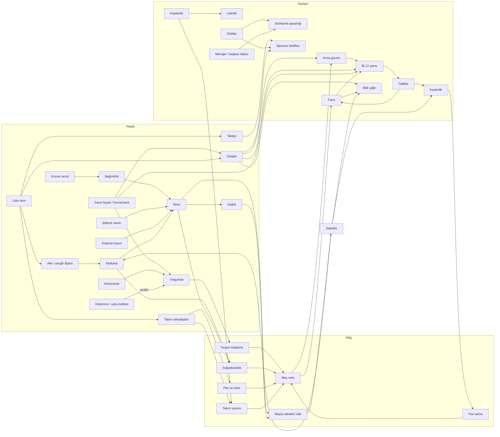

# Sistem haritası: kelebek etkisi (Ekim 2026)

Sahip ilkesi: *"Bir futbolcu yaratıp hayatını yönetiyoruz. Her şey gerçek hayattaki gibi bir bütün; en küçük
şeyin bile bir yerde etkisi olmalı."* Bu belge oyuncunun ve dünyanın her durum değerini **kimin yazdığını**
ve **kimin okuduğunu** (yani hangi sonucu doğurduğunu) listeler, ana nedensellik zincirlerini çizer, çıkmaz
sokakları (yazılan ama hiçbir sonucu olmayan değerler) ve bu turda nasıl bağlandıklarını kaydeder.

Yöntem:

- **Statik analiz.** `src/sim/**` (test dışı) üzerinde her alan için atama (`x.alan =`, `+=`, olay deltası
  `key: 'alan'`) ve okuma (`.alan`) taraması; olay bayrakları (`life.flags`) için ayrıca `setFlags` /
  `addFlags` / `flags.x =` yazımları ile `hasFlag` / `flagNum` / `flags.x` okumaları eşleştirildi. Tarayıcı
  betikleri depoya konmadı (oturum çalışma alanında), sonuçlar aşağıdaki tablolara elle işlendi.
- **Çalışma zamanı kontrolü.** `src/sim/game/butterfly.test.ts`: 23 senaryo; her biri aynı tohumdan iki
  kariyer kurar, **tek bir küçük eylemi** değiştirir ve haftalar sonraki etkiyi kontrol kopyasıyla karşılaştırır.

Kısaltmalar: *H* = `hero`, *L* = `life`, modül yolları `src/sim/` altındadır.

## 1. Etki tablosu

### 1.1 Oyuncu (H)

| Durum | Yazanlar | Okuyanlar → sonuç |
|---|---|---|
| Özellikler (`attrs`, `attrXp`) | antrenman (`career/training`), maç XP'si ve maç içi eylemler (`career/matchOutcome`), aktiviteler (spor salonu, video, mentorluk), olay kartları (`attr` deltası), yaşlanma ve hareketsizlik erimesi (`career/progression`, `career/decay`), **kaptanlık** (liderlik XP'si, yeni) | OVR → rol ve ilk 11 (`career/squadRole`), maç motoru ve anlar (`match/*`), transfer ilgisi ve maaş (`career/transfers`, `career/contract`), milli çağrı (`game/national`), sakatlık direnci (`bodyInjuryFactor`), toparlanma (dayanıklılık) |
| Form (`form`) | maç notu (`matchOutcome`), milli maç, olaylar, kumar bedeli (`life/casino`), dünya sezonu | ilk 11 şansı (%±12), maç anı sayısı (`match/engine`), piyasa değeri, transfer ilgisi, milli çağrı (%12), röportaj tonu, **lüks alışverişte taraftar tepkisi** (form < 45, yeni) |
| Moral (`morale`) | maç sonucu, rol değişimi, yedek serisi, sakatlık, tükenmişlik, röportaj, olaylar, **soğuk soyunma odası** (yeni) | mutluluk hedefi (`life/wellbeing`), maç kararları (`match/decisions`), motor |
| Maç temposu (`sharpness`) | maçta dakika (+12/90'), antrenman, haftalık −6 (dakika yoksa), sakatlık dönüşü −20 | ilk 11 (< 40: −%10), hareketsizlik erimesi (`career/decay`), **maçta pas tutma: keskinlik < 55 → fizik/teknik özellikler −%6'ya kadar** (yeni) |
| Yorgunluk (`fatigue`) | maç (+dakika, deplasman yolu), antrenman, gece hayatı, **kumarhane (+5, yeni)**, dinlenme/uyku/tesisler (−) | ilk 11 (> 60: rotasyon), antrenman XP verimi, antrenman sakatlık riski, otopilot planı, **maça yorgun başlama: yorgunluk > 40 → motorda başlangıç yorgunluğu** (yeni) |
| Sakatlık (`injury`) | maç motoru (oto anlar), antrenman, olaylar (`injury` deltası), ağrı kesici iğne kartı | oynayamama, mutluluk/stres hedefi, sağlık −8׺iddet, moral, hareketsizlik erimesi, milli çağrı (> 2 hafta: −20), sigorta ödemesi |
| Ceza (`suspendedMatches`) | kırmızı/sarı kart, olaylar, hakem defteri | oynayamama, cezayı tribünde izleme |
| Teknik direktör güveni (`managerTrust`) | maç notu, antrenman performansı, disiplin olayları, şikâyet, röportaj, haftalık sürüklenme (hoca ilişkisi + disiplin) | rol merdiveni, ilk 11 (%±8), kenara alınma riski, sözleşme yenileme (< 30 yenilenmez), stres hedefi |
| İtibar (`reputation`) | maç, sezon duruşu, kupalar, ödüller, transfer, olaylar, aktiviteler, lüks alım (ünlenme), projeler, **dost basın (yeni)** | maaş ve piyasa değeri, sponsor markaları ve teklif sıklığı, takipçi tavanı, transfer ilgisi, kumarhanede tanınma, işletme geliri, milli çağrı, Onur Listesi |
| Takipçi (`followers`) | maç, paylaşımlar, organik büyüme, olaylar, röportaj, **lüks alım fotoğrafları (yeni)** | sponsor imajı ve **teklif sıklığı (log eğrisi, yeni)**, nefret yorumları (stres), **basın baskısının şiddeti (yeni)**, hedefler |
| Ödüller (`awards`) | sezon/ay ödülleri (`game/awards`, `world/awards`) | itibar, Onur Listesi, **sözleşme pazarlığı (+%3/ödül, yeni)**, **sponsor teklif sıklığı (yeni)** |
| Sözleşme, rol | transfer/yenileme, rol değerlendirmesi | maaş, ilk 11 tabanı, **kaptan: liderlik XP'si + takım uyumu (yeni)** |

### 1.2 Hayat (L)

| Durum | Yazanlar | Okuyanlar → sonuç |
|---|---|---|
| Enerji (`energy`) | aktiviteler, antrenman, sabah yenilenmesi (uyku kalitesi, akşamdan kalma) | aktivite kilidi, **maç günü enerji < 40 → yorgun başlama (yeni)** |
| Mutluluk (`happiness`) | haftalık hedefe çekilme (yakın çevre, moral, varlıklar, borç, sakatlık), aktiviteler, olaylar, hedefler | maç soğukkanlılığı (`mentalMatchModifier`), stres hedefi, antrenman XP'si, kriz haftası (yakın arkadaş desteği) |
| Sağlık (`health`) | sakatlık, kronik stres, haftalık toparlanma, aktiviteler, olaylar | enerji tavanı, antrenman sakatlık riski, **maç sakatlık riski (yeni)** |
| Stres (`stress`) | haftalık hedef (sakatlık, borç, kumar, güvensizlik, mutsuzluk, maç yükü), işletme, sosyal medya, rol düşüşü, **düşman basın, sevgili krizi, soğuk soyunma odası, işletme zararı (yeni)** | soğukkanlılık, tükenmişlik, sağlık erimesi, antrenman ve **maç** sakatlık riski |
| Disiplin (`discipline`) | gece hayatı, kumarhane (görülme), kartlar, şikâyet, paylaşım, olaylar, **lüks şov (genç oyuncu, yeni)**, tesis yatırımı (+) | güven sürüklenmesi, sponsor imajı ve **teklif sıklığı**, taraftar grupları, **ilk 11 (< 40, yeni)**, **milli çağrı (< 40, −10'a kadar, yeni)**, **pazarlık (yeni)** |
| Para, banka, kredi, kredi notu | maaş, primler, sponsorlar, işletmeler, yatırımlar, harcamalar, kumar | mutluluk/stres hedefi (borç), iflas koruması, kredi faizi (kredi notu), satın alma kilitleri |
| Varlıklar (`assets`) | mağaza (`buyAsset`), satış, olaylar | pasif mutluluk, bakım gideri, sponsor imajı, uyku kalitesi, toparlanma tesisleri, **ev → aile/sevgili +3; gösteriş ürünü → takipçi, manşet, taraftar, kıskançlık, disiplin (yeni)** |
| İşletmeler | aç/geliştir/sat, haftalık bilanço, olay kartları | gelir, net servet, sahip stresi, **zarar haftası → stres (yeni)** |
| Projeler (akademi, stadyum, hisse, fon) | proje kartları | taraftar, itibar, mutluluk, Legacy çocuğuna itibar + para, başkan ilişkisi |
| Sponsorlar | teklif kabulü, ahlak maddesi, süre bitişi | haftalık gelir, performans primi, **provokatif paylaşım patlaması → ahlak maddesi (yeni)** |
| Kumar (`casino.addiction`, VIP) | ziyaretler, oyunlar, olaylar | stres hedefi, haftalık kumar bedeli (form, mutluluk, disiplin, yakınlar), basına sızma, **maç öncesi gece: seçilme şansı ve yorgun başlama (yeni)** |
| Bayraklar (`flags`) | olay kartları, aktiviteler, sistemler | olay koşulları ve zincirler; bkz. §3.3 (yalnızca anlatı hafızası olanlar) |
| Hedefler (objectives) | menajer, aile, sponsor, kulüp hedefleri | ödül/ceza (para, mutluluk, ilişki); **unutulan doğum günü: ilişki −8, mutluluk −3 (yeni)** |
| Başarımlar (achievements) | durum taraması | yalnızca meta ilerleme (bilinçli: dünyada sonucu yok) |

### 1.3 İlişkiler

| İlişki | Yazanlar | Okuyanlar → sonuç |
|---|---|---|
| Anne, baba, kardeşler | aile ziyareti, olaylar, ihmal erimesi, hedefler, kumar ihmali, **yeni ev (yeni)** | yakın çevre ruh hali → mutluluk → soğukkanlılık; otopilot akşam planı |
| Sevgili | randevu, olaylar, ihmal (en hızlı), kumar ihmali, **lüks alım (yeni)** | yakın çevre (×2 ağırlık), olay koşulları, **kriz (≤ −30) → haftalık stres (yeni)** |
| En yakın arkadaş, yakın arkadaşlar | aktiviteler, olaylar | yakın çevre, kriz haftası desteği, maçta pas bonusu (yakın arkadaş takım arkadaşıysa) |
| Takım arkadaşları | maç (adil suçlama), aktiviteler, olaylar, mizaç sürüklenmesi, **lüks kıskançlığı (yeni)** | pas ağı ve asist (motor `relationToHero`, `feedWillingness`), arka plan katılımı, **takım uyumu → takım morali (yeni)**, **yalnızlık stresi (yeni)** |
| Teknik direktör | maç, antrenman, disiplin, şikâyet, röportaj, golf, **tesis yatırımı (yeni)** | güven sürüklenmesi, kaptanlık şartı, röportaj |
| Menajer (agent) | işe alım, olaylar, ihmal, röportaj | **pazarlık marjı ±%4 ve sabır ±10 (yeni)** |
| Başkan | olaylar, projeler (hisse), röportaj | olay ağırlıkları, **yenilemede pazarlık marjı ±%5 (yeni)** |
| Taraftar | maç, olaylar, paylaşım, şikâyet, akademi/stadyum, memleket | nefret yorumu olasılığı, kriz haftası, transfer tepkisi, sosyal akış |
| Basın | röportaj, aktiviteler, paylaşım, kumar sızıntısı, **lüks manşeti (yeni)** | olay şartları, **düşman basın (≤ −30) → haftalık stres (takipçiyle artar); dost basın (≥ 40) → az da olsa ün (yeni)** |
| Milli takım hocası | milli maçlar, olaylar | çağrı ölçeği (%12) |

### 1.4 Dünya

| Durum | Yazanlar | Okuyanlar → sonuç |
|---|---|---|
| Kulüp sıralaması, lig, kupalar | dünya sezonu, maç sonuçları | sezon sonu ün, şampiyonluk ünü ve primleri, yönetim hedefleri, Onur Listesi, terfi primi |
| Milli takım (çağrı, kep) | çağrı ölçeği, milli maçlar | itibar, takipçi, yorgunluk ve sakatlık (milli maç), form/moral/keskinlik, başarımlar |
| Ödüller ve kupalar | sezon/ay ödülleri, şampiyonluklar | itibar, **pazarlık ve sponsor (yeni)**, Onur Listesi, Legacy |

## 2. Ana nedensellik zincirleri

## 3. Çıkmaz sokak avı

### 3.1 Bulunan ve bağlanan çıkmazlar (bu tur)

| # | Çıkmaz (önce) | Gerçek hayattaki karşılığı (şimdi) | Kod | Görünürlük |
|---|---|---|---|---|
| 1 | Yorgunluk, enerji ve gece eğlencesi yalnızca seçilmeyi etkiliyordu; seçilen oyuncu maça hep dinç başlıyordu | Yorgunluk > 40, maç günü enerji < 40 ve dün gece dışarıdaysa motorda başlangıç yorgunluğu (en fazla 0,3): bacaklar erken ağırlaşır, geç dakikalarda özellikler düşer, oyuna katılım azalır | `life/butterfly.preMatchCondition`, `match/engine.initMatch` | maç sonu "Maça nasıl geldin?", günlük |
| 2 | Keskinlik maçın kendisini etkilemiyordu | Keskinlik < 55: fizik ve teknik özellikler en fazla −%6 (pas tutma) | `applyRust`, `game/match.buildTeamFrom` | maç sonu, günlük |
| 3 | Sağlık ve stres maçta sakatlık riskini etkilemiyordu (yalnızca antrenmanda) | Yaşam kaynaklı yatkınlık (sağlık, stres > 70, tükenmişlik, `injury_resist` yeteneği) motora `proneness` olarak gider | `lifeInjuryProneness`, `match/engine.heroInjuryRisk` | maç sonu |
| 4 | Dün gece kumarhane / kulüp, ertesi günkü kadro seçimine yansımıyordu (yalnızca görülürse disiplin) | Isınmada belli olur (−%6); gece kulübü (−%6 daha) ya da kumarhanede görülme (−%9 daha) hocanın kulağına gider | `preMatchNightPenalty`, `career/squadRole.startProbability` | "Neden?" paneli: "Dün geceki kumarhane ziyareti teknik direktörün kulağına gitti." |
| 5 | Kumarhane ziyareti yorgunluk bırakmıyordu | +5 yorgunluk, maç öncesi gece disiplin −2 (gece kulübü −6 idi) | `data/activities` | aktivite özeti |
| 6 | Disiplin yalnızca güven sürüklenmesi ve sponsor imajına gidiyordu | Disiplin < 40: ilk 11 −%10'a kadar, milli çağrı −10 puana kadar, sponsor teklif sıklığı −0,05, pazarlık marjı −%3 | `disciplineSelectionPenalty`, `nationalConductPenalty`, `sponsorOfferChance`, `negotiationLeverage` | "Neden?" paneli, milli takım kartı, sponsor "Neden?", sözleşme ekranı |
| 7 | Lüks alım yalnızca ün veriyordu | Gösteriş ürünü (yıllık maaşın ≥ %5'i): takipçi, büyük alımda manşet (form düşükse ya da gençse olumsuz), form < 45 iken taraftar tepkisi, 23 yaş altında takım arkadaşları kıskanır ve sezon içinde disiplin düşer, sevgili sevinir; ev aileyi ve sevgiliyi ısıtır; tesis hocayı etkiler | `luxuryReaction`, `game/actions.buyAsset` | işlem satırı, haber, ilişki defteri ("… kıskançlığı") |
| 8 | Menajer ve başkan ilişkisi sözleşme pazarlığını etkilemiyordu | Menajer ilişkisi ±%4 marj ve ±10 sabır; başkan (yenileme) ±%5; sadakat sözü +%2 | `negotiationLeverage`, `game/actions.startNegotiation` | sözleşme ekranı "Pazarlığı etkileyenler" |
| 9 | Ödüller pazarlık ve sponsorlara doğrudan yansımıyordu (yalnızca itibar üzerinden) | Bu ya da geçen sezonun her ödülü pazarlıkta +%3 (en fazla +%9), sponsor teklif sıklığında +0,03 | aynı + `life/sponsors.sponsorOfferChance` | sözleşme ekranı, sponsor "Neden?" |
| 10 | Takipçi sponsor teklif sıklığına yalnızca 100K eşiğinde etki ediyordu | 10K üstünde her on kat +0,03 (en fazla +0,09) | `sponsorOfferChance` | sponsor "Neden?" |
| 11 | Basın ilişkisi neredeyse hiçbir şeyi etkilemiyordu | Düşman basın (≤ −30) haftalık stres (takipçi arttıkça şiddetlenir); dost basın (≥ 40) az ün | `weeklyClimate`, `game/calendar` | günlük (4 haftada bir satır) |
| 12 | Sevgili krizi ve soğuk soyunma odası doğrudan bir yük getirmiyordu | Sevgili ≤ −30: haftalık stres +2; takım ortalaması ≤ −25: stres +1,5 ve moral −1 | `weeklyClimate` | günlük |
| 13 | Takım arkadaşlarıyla bağ yalnızca pasları etkiliyordu | Takım uyumu: takım morali ±%4 (kaptan + liderlik 70 → +%1) | `dressingRoomChemistry` | maç sonu |
| 14 | Kaptanlık yalnızca baraj kurmayı ve takım kaldırmayı etkiliyordu | Kaptan olarak oynanan her 90' liderlik +0,8 XP, soğukkanlılık +0,2 XP | `career/matchOutcome` | özellik gelişimi |
| 15 | İşletme zararı stres doğurmuyordu (yalnızca sabit sahiplik stresi) | Zarar haftası: maaşa oranla stres +0,5..+4 (müdür varsa yarısı) | `life/business.weeklyBusinessTick` | günlük: "zararda: uykuların kaçıyor" |
| 16 | Provokatif paylaşım patlaması sponsorlara ulaşmıyordu | Ahlak maddesi kontrolü (gaf, şiddet 1) | `life/social.makePost` | fesih satırı ve haberi |
| 17 | `in_therapy` bayrağı yazılıyor, okunmuyordu | Terapi: soğukkanlılık +0,02, haftalık stres −1 | `life/wellbeing`, `weeklyClimate` | maç sonu (soğukkanlılık satırı) |
| 18 | `loyalty_pledge` bayrağı yazılıyor, okunmuyordu | Yenilemede pazarlık marjı +%2 | `negotiationLeverage` | sözleşme ekranı |
| 19 | `penalty_taker` bayrağı yazılıyor, okunmuyordu (penaltıcılık kartı) | Penaltıcı sensen biraz daha zayıf olsan bile vurursun (eşik ×0,85); topu arkadaşına bıraktıysan vurmazsın | `MatchSetup.heroPenaltyTaker`, `match/engine.penaltyAwarded` | maç anları |
| 20 | Unutulan anne/baba doğum günü sıradan bir akşam yemeği kadar hafifti | İlişki −8 ve mutluluk −3 → yakın çevre → soğukkanlılık | `game/objectives` | hedef sonucu, ilişki defteri |

### 3.2 Doğrulanan (zaten var olan) zincirler

- Takım arkadaşı ilişkisi → pas ağı (`feedWillingness`), asist veren seçimi (`relationWeight`), arka plan katılımı.
- Hoca güveni ↔ ilk 11 ↔ dakika ↔ keskinlik ↔ form (`squadRole`, `condition`, `matchOutcome`).
- Milli çağrı ↔ kulüp formu, dakika payı; milli maç → yorgunluk, sakatlık, form, moral.
- Sakatlık → hareketsizlik erimesi (`career/decay`), moral −4׺iddet, sağlık −8׺iddet, mutluluk/stres hedefi.
- Yaş → özellik bazında düşüş (fizik önce, oyunu okuma korunur; `weeklyAging`).
- Kumar serisi → bağımlılık → stres hedefi (+%25'e kadar) → soğukkanlılık; kumar bedeli (form, mutluluk, disiplin, yakınlar).
- Akademi → taraftar ve ün her hafta → Legacy çocuğuna itibar bonusu.
- Uyku kalitesi / dinlenme / diyet → yorgunluk toparlanması ve yaşlanmanın yavaşlaması.

### 3.3 Kalan, bilinçli olarak anlatı hafızası olan bayraklar

Aşağıdaki olay bayrakları yalnızca hikâyenin hatırlanması için yazılıyor (bir sonraki kartın metni veya
koşulu değil). Hepsi tek seferlik anı niteliğinde; bir sonraki turda olay zincirlerine bağlanmaya adaydır:
`abroad_class`, `armband_passed`, `business_curious`, `cb_link_code`, `child_letter`, `curfew_breaker`,
`diet_plan`, `family_siblings`, `fixing_backed_out`, `fixing_buried`, `fixing_cleared`, `fixing_refused`,
`foundation_pitches`, `friend_entourage`, `grandma_promise`, `homecoming_plan`, `knew_mate_bets`,
`loan_spell`, `mental_health_voice`, `museum_lent`, `nemesis_award`, `partner_sacrificed`, `relapse`,
`renewal_push`, `secret_mascot`, `smart_saver`, `stand_in_captain`, `startup_face`, `tactics_voice`,
`ultras_friend`, `wants_home`, `wants_transfer_for_partner`.

Diğer bilinçli sınırlar: başarımlar yalnızca meta ilerlemedir; kredi notu yalnızca kredi faizini belirler;
milli takımda takım uyumu uygulanmaz (soyunma odası kulübe aittir).

## 4. Zincir testleri (`src/sim/game/butterfly.test.ts`)

Her test aynı tohumla iki kopya kurar ve tek eylemi değiştirir:

| Test | Eylem | Haftalar sonra kontrol edilen |
|---|---|---|
| a | Maç öncesi gece kumarhane (kontrol: dinlenme) | ilk 11 şansı düşer, "Neden?" panelinde gece satırı, başlangıç yorgunluğu, 24 maçlık ortalamada not düşer |
| b | Annenin doğum günü atlanır | anne ilişkisi → mutluluk → soğukkanlılık çarpanı → penaltı gol olasılığı |
| c | Genç oyuncu süper araba alır | manşet, takipçi, takım arkadaşı ortalaması, disiplin, defter satırı |
| d | Bir takım arkadaşıyla kavga | oyuncunun `relationToHero` değeri ve 12 maçta ondan gelen pas sayısı |
| e | Ağrı kesiciyle oynayıp sakatlığı büyütmek | sakatlık süresi, milli çağrı ölçeği, maç sakatlık yatkınlığı |
| f | Dinlenme yerine ağır antrenman | yorgunluk, antrenman sakatlık riski, maça yorgun başlama |
| g | Kaptanlığı kabul | liderlik gelişimi, takım uyumu |
| h | Patlayan provokatif paylaşım | disiplin, basın, sponsor imajı, haber |
| i | Akademi kurmak | 26 haftada itibar, Legacy çocuğu bonusu |
| j | Kumar serisi | bağımlılık, stres, soğukkanlılık |
| k | Basını karşına almak | haftalık medya stresi ve günlük satırı |
| l | Zarar eden işletme | stres |
| m | Ödül / menajerle bozuşma | pazarlık marjı ve sabır |
| n | Disiplinsizlik | ilk 11 şansı, milli çağrı ölçeği |
| o | Soğuk soyunma odası | takım uyumu, stres, moral |
| p | Takipçi artışı | sponsor teklif sıklığı |
| q | Düşük hoca güveni | ilk 11 → keskinlik → pas tutma |
| r | Aile evi almak | aile ilişkisi, mutluluk |
| s | Yaşlanma | hız düşer, oyun görüşü korunur |
| t | Sevgili krizi | stres |
| u | Menajerle iyi ilişki | pazarlık sabrı ve marjı |
| v | Penaltıcılığı üstlenmek | 40 maçta vurulan penaltı sayısı |
| w | Mağazadan lüks alım (eylem yolu) | işlem satırı, son lüks kaydı |

## 5. Görünürlük

- **Maç sonu, "Notun nasıl oluştu?" adımı:** "Maça nasıl geldin?" listesi (dün gece, yorgunluk, enerji,
  keskinlik, sakatlık yatkınlığı, soğukkanlılık ve nedeni, soyunma odası). Aynı satırların olumsuz ilk ikisi
  maç öncesinde günlüğe de yazılır (otomatik oynanan maçlar için).
- **"Neden oynuyorum / oynamıyorum?" paneli:** dün geceki eğlence ve disiplin sicili satırları, maç öncesi
  ekranındaki yüzde de aynı hesabı kullanır (`startChance`).
- **Sözleşme ekranı:** "Pazarlığı etkileyenler" (menajer, başkan, sadakat, ödüller, disiplin).
- **Milli takım kartı:** disiplin cezası satırı.
- **Sponsor "Neden?" paneli:** ödüller ve disiplin satırları.
- **İlişki defteri:** lüks alım kaynaklı değişimler "{ürün} kıskançlığı" / "{ürün} satın aldın" gerekçesiyle.
- **Haberler:** lüks alım manşetleri (4 haftada en fazla bir), ahlak maddesi fesihleri.
